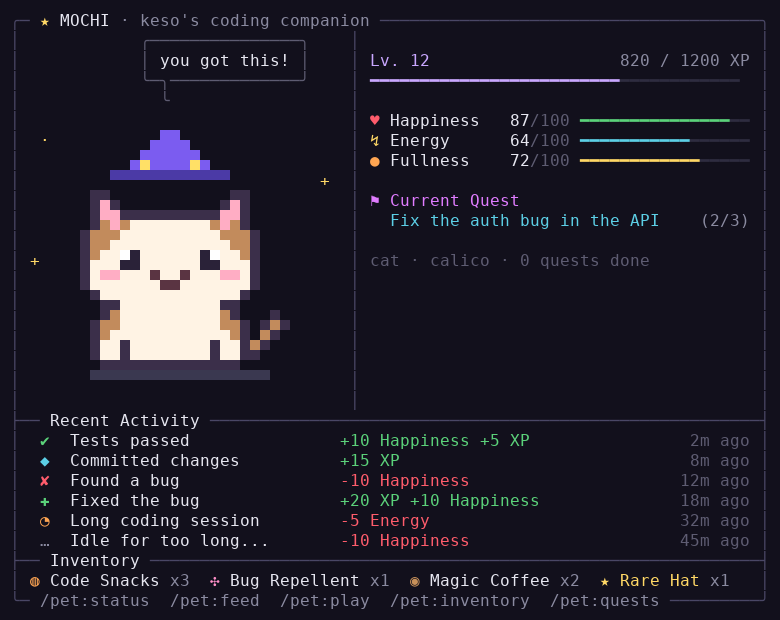

# Claude Tamagotchi

A pixel-art pet that lives in Claude Code. It cheers when your tests pass, sulks when you find a bug, panics when you delete code, and gets sleepy during long sessions. Feed it, play with it, level it up, and collect rare items.



## Install

```sh
claude plugin marketplace add kethoo/claude-tamagotchi
claude plugin install pet@claude-tamagotchi
```

Then, inside Claude Code, run once:

```
/pet:setup
```

That installs a `claude-pet` command and puts your pet in the Claude Code statusline (it leaves an existing statusline alone and tells you how to switch). Requires Node.js 18+.

For the full-color view, open a second terminal pane next to Claude Code and run:

```sh
claude-pet watch
```

It animates (blinks, sparkles, bounces), updates live as you code, and takes keys: `f` feed, `c` coffee, `p` play, `h` hat, `q` quit.

## Commands

| Command | What it does |
| :-- | :-- |
| `/pet:status` | Your pet, its stats, quest and recent activity |
| `/pet:feed [coffee]` | Feed a Code Snack (+20 fullness), or Magic Coffee (+30 energy) |
| `/pet:play` | Play together (+15 happiness, −10 energy, +5 XP) |
| `/pet:inventory` | Items collected so far |
| `/pet:quests [add <title> <steps> \| tick \| skip]` | Current quest, or add your own |
| `/pet:hat` | Wear or take off the Rare Hat |
| `/pet:name <name>` | Rename your pet |
| `/pet:species <species> [theme]` | `cat`, `bunny`, `bear` · `calico`, `gray`, `orange`, `black`, `snow`, `mint` |
| `/pet:help` | Rules at a glance |

## What it reacts to

Hooks watch the Bash commands Claude runs. Nothing is sent anywhere; everything stays in `~/.claude-pet/`.

| Event | Detected from | Effect |
| :-- | :-- | :-- |
| Tests passed | `npm test`, `pytest`, `jest`, `vitest`, `go test`, `cargo test`, … succeeding | +10 happiness, +5 XP, may drop a Code Snack |
| Found a bug | a test run failing (first failure in a streak) | −10 happiness |
| Fixed the bug | tests passing right after failing | +20 XP, +10 happiness, may drop Bug Repellent |
| Commit | `git commit` | +15 XP, may drop a Code Snack |
| Push | `git push` | +25 XP, +5 happiness, may drop Magic Coffee |
| Deleted code | `rm`, `git rm` (not build/cache folders) | −20 happiness |
| Huge error | a command failing with an error, traceback or panic | −30 happiness, −10 energy |
| Long session | every 45 minutes without a break | −5 energy |
| Idle | coming back after 45 min – 12 h away | −10 happiness |
| Rest | any break of 20+ minutes | energy recovers |

Fullness drops slowly over time. Each level needs `100 × level` XP. Bug Repellent is used automatically to cancel the next "Found a bug". The Rare Hat is legendary: a small chance on every XP gain, and guaranteed by level 10. Finishing a quest gives +50 XP and a Code Snack.

## Try it without coding

```sh
claude-pet demo test_pass
claude-pet demo error
claude-pet demo level_up
```

## Layout

```
.claude-plugin/marketplace.json    marketplace listing
plugins/pet/
  .claude-plugin/plugin.json       plugin manifest
  hooks/hooks.json                 SessionStart, UserPromptSubmit, PostToolUse(Failure), Stop
  commands/*.md                    /pet:* slash commands
  scripts/pet.js                   CLI: hook, status, watch, statusline, feed, play, …
  scripts/lib/game.js              rules, event detection, items, quests
  scripts/lib/sprites.js           pixel art (half-drawn, mirrored) + themes
  scripts/lib/render.js            ANSI panel, plain text, statusline
```

To work on it locally: `claude --plugin-dir ./plugins/pet`. Set `CLAUDE_PET_HOME` to keep a separate test pet. `claude-pet reset --yes` hatches a new one.

Colors use truecolor in modern terminals (including Windows Terminal and VS Code) and fall back to 256 colors otherwise; `NO_COLOR` is respected. On Windows, `/pet:setup` creates `claude-pet.cmd` and prints the folder to add to your PATH. In VS Code, set `"terminal.integrated.lineHeight": 1` so the pixel rows touch.
